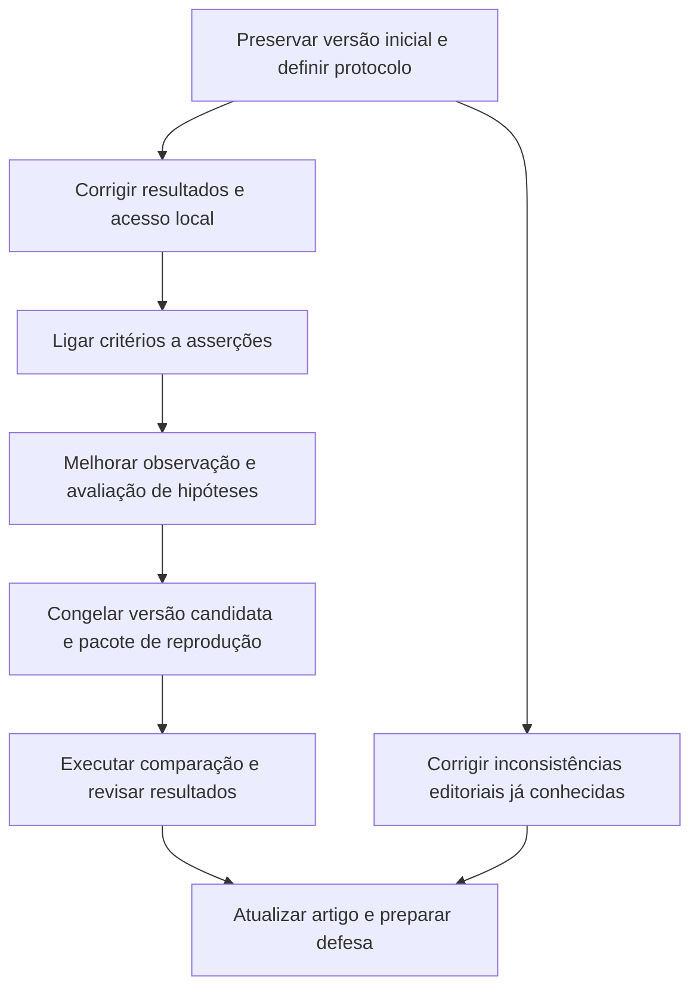

# Plano de evolução do E2P e do artigo de TCC

Data: 6 de outubro de 2026. Estado: **planejado; implementação e novos experimentos ainda não realizados**.

Ponto de partida: **7,5/10 para o projeto e 7,8/10 para o artigo**, segundo o [parecer técnico anterior](C:/Users/henri/Documents/Codex/E2P/output/AVALIACAO_E2P_2026-10-06.md). Essas notas são estimativas de revisão, não notas oficiais. A execução deste plano melhora os fundamentos da avaliação; não garante uma nota específica.

**Objetivo:** tornar o E2P capaz de explicar o que foi realmente verificado, detectar regressões em comportamentos delimitados e produzir resultados que outra pessoa consiga conferir e reproduzir. O artigo deve demonstrar essas capacidades com medidas adequadas, inclusive quando os resultados forem negativos.

## 1. Roteiro em uma página

| Ordem | Entrega | Por que aumenta a qualidade | Condição para avançar |
|---|---|---|---|
| 0 | Versão inicial preservada e protocolo preliminar | Permite comparar antes e depois sem reconstruir o passado | Código, configuração e evidências identificados |
| 1 | Resultados honestos e servidor restrito ao uso local | Evita sucesso indevido, cobertura enganosa e exposição de artefatos | Falhas e ausência de evidência aparecem corretamente |
| 2 | Critério de aceitação ligado à asserção | Corrige o principal limite funcional | Casos conhecidos distinguem comportamento correto de defeituoso |
| 3 | Observação de diálogos, entradas sintéticas e hipóteses fundamentadas | Reduz bloqueios artificiais e falsos positivos | Expense Tracker e contradição do Meal Finder resolvidos |
| 4 | Registro uniforme e pacote reproduzível | Sustenta a metodologia e as tabelas do artigo | Execução e agregação reproduzíveis a partir de instruções |
| 5 | Avaliação comparativa com casos de referência | Mede eficácia, estabilidade e limites | Resultados completos, incluindo falhas e interrupções |
| 6 | Artigo revisado e ensaio de defesa | Faz as conclusões corresponderem às evidências | PDF conforme regulamento e afirmações rastreáveis |

**Prioridade em caso de conflito:** validade dos testes → validade dos achados → reprodução → apresentação. As correções pequenas de exposição local e de classificação de falhas devem ser feitas cedo, sem interromper o trabalho no gerador.

## 2. Regras de execução

- Marcar uma tarefa concluída somente quando houver entrega e evidência de aceitação. Código alterado, isoladamente, não encerra a tarefa.
- Preservar os resultados anteriores. Uma execução corrigida recebe outro identificador e não substitui um experimento histórico.
- Distinguir teste de regressão do E2P, teste gerado para um alvo e avaliação científica da ferramenta. São três medidas diferentes.
- Usar os exemplos já inspecionados como casos de desenvolvimento. Não chamá-los de avaliação cega ou de projetos desconhecidos.
- Registrar decisões de escopo e protocolo antes da coleta final. Mudanças posteriores devem ser declaradas.
- Evitar adaptações por nome de projeto. As correções devem tratar classes de comportamento: persistência, valor calculado, seleção, diálogo e mudança de estado.
- Fazer verificações proporcionais à mudança: testes dirigidos ao contrato afetado durante o desenvolvimento e suíte completa nos marcos de integração. Não repetir um benchmark caro sem mudança ou dúvida que justifique a repetição.

**Papéis:** a implementação e a coleta podem ser assistidas por automação; Henrique responde pela compreensão, verificação e interpretação. O orientador ajuda a delimitar contribuição e protocolo. Um segundo avaliador, quando disponível, revisa casos e julgamentos sem receber a resposta do E2P como gabarito. Sua ausência deve ser declarada, não simulada por outro papel do mesmo modelo.

## 3. Etapa 0 — Fixar o ponto de partida

### A01 — Preservar a versão V0 e organizar as evidências

**Dependência:** nenhuma. **Esforço estimado:** 2–4 horas de trabalho ativo.

**Ações**

- [ ] Preservar uma cópia identificada do código atual, dos manifestos de dependências e da configuração do modelo antes de editar o produto.
- [ ] Organizar versionamento local com cuidado: a pasta avaliada não possuía `.git`. Relacionar a cópia local ao repositório sem sobrescrever suas alterações; não substituir pelo conteúdo remoto.
- [ ] Identificar V0 por commit ou manifesto de hashes, incluindo arquivos locais divergentes.
- [ ] Registrar versões do navegador, runtime, modelo/projetor, parâmetros, limites e hardware. Pesos grandes podem ser identificados por hash e origem, sem duplicação em cada execução.
- [ ] Preservar os lotes de outubro e os casos da revisão de 6/10 em um índice de evidências.
- [ ] Escrever o protocolo preliminar de seleção, comparação, métricas e tratamento de falhas descrito na etapa 5.

**Entrega:** versão V0 recuperável, manifesto do ambiente e índice de experimentos. A forma de armazenamento pode ser simples; um banco de dados não é necessário.

**Aceitação:** alguém consegue identificar qual código e configuração produziram cada conjunto de resultados. Se não for possível reconstruir uma revisão histórica, essa limitação fica explícita e V0 passa a representar o estado preservado agora.

**Ganho no artigo:** base concreta para metodologia, rastreabilidade e comparação entre versões.

## 4. Etapa 1 — Evitar conclusões indevidas

### A02 — Separar execução concluída de resultado aprovado

**Dependência:** A01. **Esforço:** 4–8 horas.

Pontos iniciais: [executor](C:/Users/henri/Documents/Codex/E2P/action-e2e/src/services/test-runner.js), [consolidação](C:/Users/henri/Documents/Codex/E2P/action-e2e/src/services/insight-builder.js) e [fila](C:/Users/henri/Documents/Codex/E2P/action-e2e/src/services/batch-runner.js).

- [ ] Distinguir estado operacional da execução e resultado dos testes. Uma operação pode terminar normalmente e conter testes reprovados.
- [ ] Representar aprovação, reprovação por asserção, bloqueio por política, erro de infraestrutura e ausência de verificação sem colapsá-los em um único total.
- [ ] Validar código de saída, erros globais do Playwright, relatório presente e correspondência com os testes esperados. Um código de saída não zero também pode representar reprovação legítima, devendo ser interpretado com o relatório.
- [ ] Tratar relatório ausente, corrompido, vazio indevidamente ou execução parcial como resultado incompleto/erro, conforme a causa.
- [ ] Exibir essas distinções no histórico e no resumo, preservando a evidência já coletada se a interpretação final pelo modelo falhar.

**Aceitação:** casos de relatório ausente, JSON inválido, navegador indisponível, suíte parcialmente executada, asserção reprovada e execução aprovada recebem resultados distintos e corretos. Nenhum resumo transforma zero testes em garantia de sucesso.

### A03 — Corrigir a exposição do servidor e revisar dependências

**Dependência:** A01. **Esforço:** 3–6 horas.

Ponto inicial: [servidor](C:/Users/henri/Documents/Codex/E2P/action-e2e/src/server.js).

- [ ] Definir endereço de escuta explicitamente local e revisar Host/Origin e acesso às rotas sensíveis.
- [ ] Proteger artefatos sem quebrar a exibição de imagens, vídeos e rastros na interface; escolher mecanismo compatível com esses recursos, como sessão local validada, em vez de exigir cabeçalho que uma imagem comum não envia.
- [ ] Manter a quarentena e a redação de segredos existentes.
- [ ] Refazer a auditoria de dependências no momento da implementação, atualizar de forma controlada e registrar alertas remanescentes com sua aplicabilidade.

**Aceitação:** uso normal pelo endereço local continua funcionando; a aplicação não escuta nas demais interfaces; acessos sem o contexto autorizado são rejeitados quando exigido. A suíte de autenticação e os testes de evidências continuam funcionando.

**Ganho no artigo:** coerência entre a arquitetura descrita como local e o comportamento efetivo. Não converter essa verificação em alegação de segurança absoluta.

### A04 — Corrigir o significado da cobertura

**Dependência:** A02; integração final com A05. **Esforço:** 4–8 horas.

Ponto inicial: [cobertura QA](C:/Users/henri/Documents/Codex/E2P/action-e2e/src/services/qa-coverage.js).

- [ ] Separar oportunidade identificada, ação exercitada e resultado efetivamente verificado.
- [ ] Representar falta de objetivos ou denominador como `não mensurável`.
- [ ] Não dar crédito de persistência somente pela presença de recarga, nem de cálculo apenas por mudança numérica.
- [ ] Manter critérios bloqueados ou não suportados visíveis no denominador aplicável, com motivo, para evitar que remover casos difíceis aumente artificialmente a cobertura.
- [ ] Exibir quantidades e bases de cálculo junto de qualquer porcentagem.

**Aceitação:** zero objetivos não gera 100%; recarregar sem criar e conferir um objeto não comprova persistência; observar um contador não comprova cálculo de domínio. O relatório permite localizar a asserção que sustenta cada item declarado verificado.

## 5. Etapa 2 — Tornar os testes funcionalmente significativos

### A05 — Criar um contrato entre critério e asserção

**Dependência:** A01 e A02. **Esforço:** 12–24 horas. **Maior prioridade técnica.**

Pontos iniciais: [planejamento](C:/Users/henri/Documents/Codex/E2P/action-e2e/src/services/ai-workflows.js), [gerador](C:/Users/henri/Documents/Codex/E2P/action-e2e/src/services/test-generator.js) e [critérios e fluxos](C:/Users/henri/Documents/Codex/E2P/action-e2e/src/services/flow-planner.js).

- [ ] Definir representação intermediária validada para critérios e verificações.
- [ ] Para cada critério, registrar identificador, origem da expectativa, pré-condição, ação, entidade observada, resultado esperado, comparação e evidências de suporte.
- [ ] Distinguir requisito fornecido, comportamento inferido e simples observação. Um comportamento observado no alvo defeituoso não pode automaticamente se tornar o comportamento correto esperado.
- [ ] Começar com poucas verificações gerais: valor exato/alterado, entidade criada, estado selecionado, estado de painel, persistência de entidade e valor calculado quando houver regra explícita.
- [ ] Vincular cada asserção ao identificador do critério e mostrar essa relação na revisão antes da execução.
- [ ] Gerar verificação superficial somente como smoke identificado. Se a intenção não puder ser verificada, manter o critério como não verificado ou pedir revisão no fluxo do produto.
- [ ] Fazer critérios editados passarem novamente por validação e regeneração; impedir que o título mude e o teste permaneça semanticamente antigo.

**Exemplo de contrato desejado**

| Campo | Conteúdo ilustrativo |
|---|---|
| Critério | Uma transação válida permanece após recarga |
| Pré-condição | Armazenamento de teste limpo |
| Ações | Informar descrição e valor; adicionar; recarregar |
| Observação necessária | A mesma transação e seu valor existem antes e depois da recarga |
| Asserção | Comparar identidade/conteúdo da transação e saldo esperado |
| Limite | Conferir o título da página não atende esse critério |

**Aceitação:** todos os critérios declarados verificados têm verificações correspondentes; critérios sem suporte permanecem explícitos. Ter um identificador ligado a uma asserção é necessário, mas também deve ser revisado se a comparação realmente representa o critério.

### A06 — Validar com regressões conhecidas antes de ampliar o escopo

**Dependência:** A05; Expense Tracker também depende de A07. **Esforço:** 6–12 horas.

| Caso de desenvolvimento | Comportamento esperado | Alteração defeituosa para verificação |
|---|---|---|
| Music Player | Botão anterior troca o título da faixa | Remover o manipulador dessa ação |
| Expense Tracker | Transação válida atualiza saldo | Impedir a atualização do saldo |
| Expense Tracker | Transação persiste após recarga | Impedir a gravação ou recuperação no armazenamento |
| Typing Game | Alteração da dificuldade é observável no estado pertinente | Ignorar a mudança de dificuldade |
| Typing Game | Painel abre/fecha conforme o comando | Remover a mudança de visibilidade |

- [ ] Definir precisamente o resultado esperado e validar cada alteração defeituosa com uma verificação independente do E2P.
- [ ] Gerar e congelar a suíte, depois executá-la sem adaptações sobre o par defeituoso/correto em ambientes limpos.
- [ ] Confirmar que a reprovação decorre do comportamento pretendido, e não de servidor indisponível ou seletor quebrado sem relação com o defeito.
- [ ] Registrar resultados por caso e preservar os que continuarem não sendo detectados.

**Aceitação do marco técnico:** os comportamentos que forem anunciados como suportados distinguem os pares correspondentes. Se algum ainda falhar, restringir a capacidade declarada e manter o problema aberto. No Music Player, verificar a troca do título não comprova reprodução audível; esse limite deve continuar explícito.

**Ganho no artigo:** exemplo concreto de sensibilidade a defeitos, em vez de apenas contagem de testes aprovados. Esses casos já conhecidos são regressão de desenvolvimento, não evidência de generalização.

## 6. Etapa 3 — Melhorar observação e julgamento

### A07 — Capturar diálogos e permitir entradas sintéticas necessárias

**Dependência:** A02. **Esforço:** 6–12 horas.

Pontos iniciais: [observação](C:/Users/henri/Documents/Codex/E2P/action-e2e/src/services/live-explorer.js), [explorador](C:/Users/henri/Documents/Codex/E2P/action-e2e/src/services/agentic-explorer.js) e [reprodução](C:/Users/henri/Documents/Codex/E2P/action-e2e/src/services/hypothesis-reproducer.js).

- [ ] Capturar eventos de diálogo nativo, incluindo tipo, mensagem, instante, ação associada e decisão de aceitar/dispensar.
- [ ] Aplicar observação e tratamento consistentes na exploração, reprodução e suíte gerada.
- [ ] Adicionar um perfil explícito de ambiente descartável, com entradas numéricas sintéticas e limites conhecidos. Rodar em localhost, isoladamente, não prova que o alvo seja descartável ou não tenha integrações externas.
- [ ] Tratar e-mail e senha sintéticos apenas se forem necessários ao recorte escolhido; evitar ampliar todos os tipos de interação nesta etapa.
- [ ] Restaurar armazenamento e estado do alvo entre tentativas conforme o protocolo.

**Aceitação:** o alerta de valor vazio no Expense Tracker é registrado como feedback existente; uma transação sintética válida é criada e verificada; o perfil conservador existente continua restringindo alvos fora do ambiente de teste delimitado.

### A08 — Exigir procedência e resolver contradições nas hipóteses

**Dependência:** A07. **Esforço:** 6–12 horas.

Pontos iniciais: [descoberta de defeitos](C:/Users/henri/Documents/Codex/E2P/action-e2e/src/services/bug-discovery.js) e [reprodução](C:/Users/henri/Documents/Codex/E2P/action-e2e/src/services/hypothesis-reproducer.js).

- [ ] Exigir referência a evento registrado para toda classificação de diagnóstico de runtime; impedir que o modelo atribua essa procedência por texto livre.
- [ ] Separar fatos observados, expectativa, fonte da expectativa, comparação e decisão.
- [ ] Derivar o resultado das verificações fundamentadas; conflitos não resolvidos devem gerar revisão/inconclusão, com evidência preservada.
- [ ] Manter correção de resposta limitada por orçamento; evitar loops de reconsideração até obter uma resposta conveniente.
- [ ] Ampliar os testes com paráfrases e casos de desenvolvimento distintos. Não tratar a adição de expressões regulares como solução geral de coerência semântica.
- [ ] Preservar a distinção entre reproduzir uma observação, reproduzir uma exceção e confirmar um defeito.

**Aceitação:** o caso contraditório do Meal Finder deixa de ser apresentado como hipótese sustentada sem resolver o conflito; alerta nativo não vira exceção de runtime; referências inexistentes são rejeitadas; limitações e achados inconclusivos aparecem no relatório.

**Ganho no artigo:** análise verificável dos motivos de falsos positivos e do efeito das correções. A eficácia geral do crítico ainda será medida, não presumida.

## 7. Etapa 4 — Preparar a reprodução

### A09 — Unificar registros e gerar os resultados a partir dos dados

**Dependência:** A02–A08 para congelar a versão final; o trabalho de registro pode começar antes. **Esforço:** 8–16 horas.

Pontos iniciais: [logs](C:/Users/henri/Documents/Codex/E2P/action-e2e/src/services/run-log.js), [fila](C:/Users/henri/Documents/Codex/E2P/action-e2e/src/services/batch-runner.js), [execução por comando](C:/Users/henri/Documents/Codex/E2P/action-e2e/scripts/run-blind-local-evaluation.cjs) e [servidor](C:/Users/henri/Documents/Codex/E2P/action-e2e/src/server.js).

- [ ] Compartilhar os contratos de orquestração e registro entre interface, lote e comando, extraindo o necessário sem reescrever toda a arquitetura.
- [ ] Salvar logs também em interrupções e falhas antes da geração.
- [ ] Incluir versão/hash do E2P, alvo e seus arquivos modificados, modelo/projetor, parâmetros, prompts/versionamento, limites, acesso, início/fim, tentativas e revisões humanas.
- [ ] Registrar chamadas, tokens quando informados pelo provedor e duração por etapa. Marcar dados indisponíveis como ausentes, não zero.
- [ ] Criar agregação que produza tabela por execução, resumo por aplicação e tabelas do artigo a partir dos mesmos dados.
- [ ] Corrigir ou justificar a divergência histórica de 107/91 versus 105/92 e atualizar a documentação de testes internos.
- [ ] Documentar instalação, preparação dos alvos, execução, agregação e leitura dos resultados. Testar em uma instalação limpa ou pedir reprodução externa; declarar qual alternativa foi feita.

**Entrega sugerida:** um diretório de avaliação com protocolo, manifestos, casos, resultados brutos, julgamentos e tabelas derivadas. Os nomes serão definidos na implementação; esses itens ainda não existem por força deste plano.

**Aceitação:** interface, lote e comando produzem o mesmo esquema de evidências; todos os valores publicados são calculáveis a partir de execuções identificadas; a versão candidata V1 fica congelada para coleta.

## 8. Etapa 5 — Produzir evidência científica

### A10 — Comparar versões e avaliar a utilidade dos testes

**Dependência:** A01 para definir protocolo; A06, A08 e A09 para executar a coleta final. **Esforço ativo:** 10–20 horas, além da inferência e dos replays.

**Perguntas de pesquisa propostas**

1. A versão revisada gera verificações que correspondem melhor aos critérios de aceitação?
2. As suítes produzidas detectam defeitos delimitados e aceitam as versões corrigidas?
3. Quais custos, interrupções e falsos positivos permanecem, e em quais condições?

**Recorte recomendado**

- Selecionar inicialmente seis aplicações pequenas, com um comportamento principal e um par defeituoso/corrigido por aplicação. Se o prazo permitir, ampliar depois de validar o protocolo.
- Separar casos usados nas correções dos casos reservados para avaliação. Para uma alegação de generalização, incluir aplicações ou comportamentos não utilizados para ajustar a ferramenta e registrar exposição anterior. Os 21 projetos já examinados não são um conjunto totalmente desconhecido.
- Usar três repetições por aplicação e versão, com orçamento igual, modelo/configuração iguais e ordem alternada de V0/V1. Mais repetições são desejáveis se a variabilidade observada justificar e o prazo permitir.
- Preservar falhas de geração, timeouts e bloqueios como resultados. Reexecução por problema ambiental deve seguir regra estabelecida e manter a tentativa original.

**Duas avaliações que não devem ser confundidas**

| Avaliação | Procedimento | O que pode demonstrar |
|---|---|---|
| Qualidade da suíte de regressão | Gerar na versão correta de referência; congelar a suíte; executar a mesma suíte nos dois membros do par | Capacidade de detectar a regressão escolhida |
| Descoberta de defeitos | Executar exploração sobre alvos designados sem fornecer o defeito, patch ou gabarito; revisar hipóteses emitidas | Qualidade dos achados naquele conjunto |

Gerar o teste diretamente no alvo defeituoso e usar seu comportamento observado como resultado correto criaria um oráculo circular. Dar ao agente a descrição do defeito também mudaria o estudo para reprodução orientada por relato. Cada protocolo deve deixar claro o que a ferramenta recebeu.

**Dimensionamento do estudo de suítes:** seis aplicações × duas versões do E2P × três repetições = **36 tentativas de geração/exploração**. Se todas produzirem uma suíte elegível, serão **72 execuções de replay** sobre os pares correto/defeituoso. Esse é um orçamento de execuções, não uma previsão de duração. A descoberta cega, caso incluída como experimento separado, exige orçamento adicional.

V0 versus V1 mede o efeito do conjunto de alterações. Para atribuir o ganho especificamente ao novo compilador, acrescentar, se viável, comparação com as mesmas trajetórias e critérios congelados, alterando somente o compilador. Comparações de modelo, visão, crítico e memória ficam fora do experimento principal.

### A11 — Medir com denominadores claros e revisão humana

**Dependência:** definição em A10, cálculo após coleta. **Esforço ativo:** 6–12 horas, mais disponibilidade do segundo avaliador.

| Medida | Definição operacional | Cuidados |
|---|---|---|
| Conclusão operacional | Tentativas que chegam à execução / tentativas planejadas | Mostrar estágio e causa das demais |
| Adequação semântica | Critérios cujo teste realmente verifica o efeito / critérios avaliados | Revisão da intenção e da asserção; mostrar quantos ficaram sem teste |
| Discriminação do par | Casos em que a suíte passa no correto e falha pelo defeito no defeituoso / casos planejados elegíveis | Publicar também resultado condicionado à geração; falha de infraestrutura não conta como detecção |
| Precisão dos alertas | Alertas corretos / alertas adjudicados como corretos ou incorretos | Exibir inconclusivos, duplicatas e quantidade revisada separadamente |
| Detecção de defeitos de referência | Defeitos conhecidos detectados / defeitos de referência elegíveis | Aplicável ao protocolo de descoberta, não à simples execução de suíte; não estima todos os defeitos naturais |
| Custo | Tempo total, tempo por etapa, chamadas/tokens disponíveis e esforço humano | Incluir tentativas malsucedidas; não confundir tokens/s com produtividade |
| Variação | Resultados por aplicação e repetição | Não tratar todas as asserções do mesmo projeto como amostras independentes |

- [ ] Criar gabarito de requisitos e validar os defeitos antes da coleta final, separado do contexto fornecido ao agente.
- [ ] Preparar critérios de julgamento de alertas e asserções, usando exemplos de desenvolvimento.
- [ ] Anonimizar V0/V1 para revisão humana quando possível.
- [ ] Pedir a um segundo avaliador que revise todos os casos se o conjunto for pequeno, ou uma amostra definida previamente que inclua ambas as versões e diferentes resultados.
- [ ] Preservar avaliações individuais antes da conciliação e registrar divergências. Uma medida de concordância pode complementar a descrição quando houver dados suficientes.
- [ ] Apresentar resultados por aplicação, números absolutos e dispersão. Com poucos projetos e repetições, priorizar análise descritiva; intervalos ou testes estatísticos exigem unidade de análise e hipóteses justificadas.
- [ ] Encerrar a coleta conforme o protocolo. Não continuar rodando até a nota ou a taxa desejada aparecer.

**Aceitação científica:** há dados suficientes para responder às perguntas delimitadas, mesmo que V1 não supere V0. Um resultado desfavorável exige análise e limitação da conclusão; não invalida automaticamente o trabalho de pesquisa.

## 9. Etapa 6 — Revisar o artigo

### A12 — Atualizar a narrativa, as tabelas e a apresentação

**Dependência:** correções editoriais podem começar após A01; resultados finais dependem de A11. **Esforço:** 8–16 horas.

Fonte atual: [main.tex](C:/Users/henri/Documents/Codex/E2P/latex/final-prototype/main.tex). PDF avaliado: [E2P_final_prototype.pdf](C:/Users/henri/Documents/Codex/E2P/output/pdf/E2P_final_prototype.pdf).

| Parte | Ação concreta | Evidência necessária |
|---|---|---|
| Título e objetivos | Centrar o trabalho na avaliação da pipeline, salvo se houver comparação real de modelos | Escopo final aprovado pelo autor e alinhado com orientação |
| Resumo/abstract | Informar amostra, comparação, principal resultado e limite | Valores derivados dos logs; descrição fiel da participação humana e da IA |
| Trabalhos relacionados | Explicitar diferenças de entrada, oráculo e avaliação em uma síntese compacta | Fontes primárias já utilizadas, conferidas para cada afirmação |
| Metodologia | Descrever V0/V1, seleção, pares, repetições, limites, revisão e falhas | Protocolo, manifestos e gabarito |
| Implementação | Explicar o contrato critério–asserção e a procedência das hipóteses | Exemplo real e esquema de dados conciso |
| Resultados | Separar conclusão operacional, adequação das asserções e detecção de defeitos | Tabelas geradas automaticamente e casos de sucesso/falha |
| Discussão | Explicar onde melhorou, onde não melhorou e causas sustentadas | Comparações e exemplos concretos, sem atribuição causal indevida |
| Ameaças à validade | Incluir amostra pequena, exposição prévia, seleção dos defeitos e papel dos revisores | Limitações reais do protocolo executado |
| Conclusão | Responder às perguntas, limitando o alcance ao conjunto estudado | Não alegar economia de trabalho sem medir esforço líquido |
| Reprodução e IA | Indicar pacote, revisão e contribuição efetiva das ferramentas | Link/versionamento acessível e declaração consistente |

**Correções editoriais imediatas**

- [ ] Resolver a divergência de ações/estados da página 12 com o snapshot correto.
- [ ] Substituir ou qualificar a alegação de redução de trabalho não medida.
- [ ] Harmonizar “Manual examination” com a descrição real da auditoria assistida por IA.
- [ ] Atualizar números de testes internos e versões sem misturar verificação atual com experimentos antigos.

**Orçamento de espaço proposto:** 1,5 página para resumo/introdução; 2 para referencial; 3 para metodologia; 2 para implementação; 4 para resultados/discussão; 1,5 para ameaças/conclusão/declaração; 2 para referências. Total aproximado: 16 páginas. É uma orientação editorial, não uma exigência de proporções.

O artigo já ocupa 16 páginas. Substituir descrições repetidas por uma matriz de resultados e um exemplo completo de critério, asserção e defeito. Detalhes extensos de instalação e registros devem ficar no material de reprodução. Manter LaTeX/SBC, os componentes exigidos, pelo menos dez referências e a declaração de IA. Apêndices dependem das condições do regulamento e da orientação; não usá-los para presumir que o limite de páginas deixou de valer.

**Aceitação:** PDF compilado e inspecionado visualmente; números rastreáveis; terminologia consistente; todas as perguntas respondidas; nenhuma afirmação de eficácia superior ao que foi medido. Comparar com o TCC de Arthur quanto ao encadeamento experimental e clareza, sem transportar métricas inadequadas de outro domínio.

### A13 — Preparar demonstração e defesa

**Dependência:** A11 e A12. **Esforço:** 3–6 horas.

- [ ] Preparar roteiro dentro dos 20 minutos previstos no regulamento fornecido, confirmando eventuais orientações complementares.
- [ ] Mostrar um exemplo de teste antigo permissivo, sua verificação revisada e o par defeituoso/corrigido.
- [ ] Mostrar também uma limitação ou caso inconclusivo e explicar o que a ferramenta faz nessa situação.
- [ ] Manter artefatos e gravação de apoio para que a apresentação não dependa de inferência ao vivo.
- [ ] Ensaiar respostas: qual é a contribuição; o que o modelo decide; o que é determinístico; de onde vem o oráculo; como foram julgados os achados; o que não generaliza.

**Aceitação:** o autor consegue explicar e defender as decisões e resultados sem depender do texto produzido por ferramentas.

## 10. Sequência de trabalho e estimativa

Como não foi informada uma data de entrega, a sequência usa marcos. As estimativas são de planejamento e devem ser revistas após o primeiro ciclo; não são compromisso de calendário.

| Bloco | Tarefas | Trabalho ativo estimado | Saída |
|---|---|---:|---|
| Preparação | A01 | 2–4 h | V0 e protocolo preliminar |
| Resultados e acesso | A02, A03, início de A04 | 11–22 h | Sem sucesso ou cobertura enganosa |
| Testes úteis | A05, A06, A07, conclusão de A04 | 24–48 h, sem contar A04 novamente | Critérios com verificações demonstradas |
| Hipóteses e reprodução | A08, A09 | 14–28 h | V1 congelada e dados agregáveis |
| Avaliação | A10, A11 | 16–32 h | Comparação e julgamentos preservados |
| Texto e defesa | A12, A13 | 11–22 h | Artigo e apresentação coerentes |

Ordem de grandeza total: **78–156 horas de trabalho ativo**, além de execução de modelos e disponibilidade de revisores. Parte da redação e do registro pode ocorrer durante a implementação. Antes de fechar um calendário, medir duas execuções piloto e estimar coleta, armazenamento e revisão com dados da própria máquina.

### Se o prazo for curto

Preservar A01; fazer A02/A03; implementar A05 com escopo reduzido; executar A06/A07; coletar comparação menor e explícita; concluir A12. Para A08, se não houver tempo de corrigir a coerência, apresentar achados como pendentes e submeter sua classificação a revisão humana, sem afirmar que o problema foi resolvido.

Reduzir quantidade de aplicações e de funcionalidades antes de eliminar repetição, verificação de comportamento ou preservação das falhas. Uma amostra menor limita a generalização e deve ser declarada. As correções editoriais melhoram precisão do texto, mas não substituem evidência experimental.

## 11. O que fica para depois

- Comparação extensa entre modelos, quantizações e provedores.
- Agentes adicionais e arquiteturas multiagentes mais complexas.
- Suporte amplo a áudio, voz, mobile, múltiplos navegadores e aplicações corporativas autenticadas.
- Novos dashboards, redesenho geral da interface ou troca de toda a stack.
- Refatoração de todos os módulos apenas por tamanho.

Esses itens entram quando houver uma pergunta de pesquisa ou necessidade demonstrada que justifique seu custo. No ciclo atual, o trabalho principal é validar as verificações e tornar os resultados reproduzíveis.

## 12. Quadro de acompanhamento

| ID | Estado inicial | Evidência necessária para encerrar |
|---|---|---|
| A01 | Pendente | V0, manifesto e protocolo |
| A02 | Pendente | Casos de falha/resultados classificados corretamente |
| A03 | Pendente | Acesso local e artefatos verificados; auditoria atualizada |
| A04 | Pendente | Cobertura com denominador e critério de verificação |
| A05 | Pendente | Contrato e rastreabilidade critério–asserção |
| A06 | Pendente | Resultados dos pares de desenvolvimento |
| A07 | Pendente | Alertas observados e transação sintética validada |
| A08 | Pendente | Procedência e conflito de julgamento tratados |
| A09 | Pendente | Logs uniformes e tabelas reproduzíveis |
| A10 | Pendente | Coleta completa conforme protocolo |
| A11 | Pendente | Métricas, julgamentos e divergências preservados |
| A12 | Pendente | PDF revisado e verificado |
| A13 | Pendente | Demonstração e ensaio de defesa |

Ao atualizar uma linha, acrescentar a revisão do código, IDs das execuções, link da evidência e limitação remanescente. Usar estados simples: pendente, em andamento, bloqueado por dependência e concluído com evidência.

**Primeira ação concreta:** executar A01 e abrir o caso Music Player como regressão de desenvolvimento de A05/A06. Ele oferece uma comparação curta e objetiva entre um teste que apenas passa e um teste que detecta o comportamento quebrado.

**Condição para pedir nova avaliação:** implementação identificada; principais casos técnicos verificados; resultados novos completos; protocolo e tabelas reproduzíveis; artigo atualizado. A faixa de 8–8,5 torna-se plausível com correções centrais comprovadas. Uma avaliação próxima de 9 exige, sobretudo, uma contribuição bem delimitada e evidência científica consistente, não necessariamente muitas funcionalidades adicionais.
